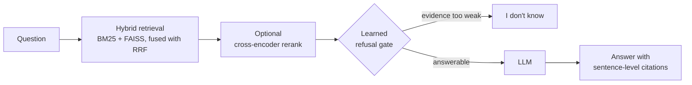

  

  
  
  

## About me

I'm an **M.Sc. Computer Science (Big Data & AI) student at SRH University Berlin**. I build machine-learning and data applications in Python, from the model through the API to the UI.

My projects are tested, evaluated on held-out data, and honest about their limits. I care most about the parts that usually get skipped: refusing when the evidence is weak, measuring results without inflating them, and protecting personal data.

## What I care about

| | Principle | Where it shows up |
|---|---|---|
| 🧪 | **Measured, not claimed** | Held-out benchmarks, ablations, and every error listed by ID ([RAGLens](https://github.com/ronith21/raglens)) |
| 🛡️ | **Safe by default** | A refusal gate that checks the evidence before the LLM is called, a crisis circuit-breaker, and deterministic triage scoring |
| 🔒 | **Privacy-aware** | PII masking (e-mail, IBAN, card, phone) before anything is logged |
| ⚙️ | **Production habits** | High test coverage, strict typing, CI, Docker, metrics and request tracing |

## ⭐ Featured project: [RAGLens](https://github.com/ronith21/raglens)

> **Answers you can check, refusals you can trust.** RAGLens answers questions about banking regulation. Every sentence cites the exact source sentence it came from, and when the documents don't cover a question, it says "I don't know".

| Result (held-out data) | Value |
|---|---|
| Unanswerable questions correctly refused | **87.5%** with the learned gate vs 50% with a hand-tuned rule |
| Answerable questions wrongly refused | **4.2%**, down from 16.7% |
| Retrieval hit@5 on the banking corpus (hybrid) | **0.96 to 1.00** across chunk sizes |
| Engineering | 188 tests · 98% coverage · strict mypy · CI on Python 3.11 / 3.12 · Docker |

Python · FastAPI · Streamlit · FAISS · rank-bm25 · scikit-learn · Prometheus · Hugging Face Spaces

## 🚧 Currently building

| Project | What it does | Stack |
|---|---|---|
| **TaskHive** | Multi-agent harness: a lead agent splits a job into tasks, helper agents work them over a shared SQLite board, and a grader checks the results | Python · SQLite · pytest |
| **Card Risk: SQL + Excel** | Fraud-risk analysis of card transactions with SQL queries and a formula-driven Excel workbook | SQL · SQLite · Excel · Python |
| **Lead Intelligence Engine** | Ingests company lists, scores leads with explainable rules and drafts outreach in German and English | Python · FastAPI · SQLite · Streamlit |

## 📁 More projects

| Project | What it does | Stack |
|---|---|---|
| **Sage Clinical Assistant** | Safety-first triage assistant: deterministic ESI v4 scoring, a crisis circuit-breaker, and failover across several LLMs | Python · FastAPI · NiceGUI |
| **Berlin Transit Intelligence** | Transit data platform that predicts arrival delays on Deutsche Bahn data | Python · FastAPI · NiceGUI · scikit-learn · Docker |
| **Fraud Anomaly Analytics** | Streaming fraud detection with cost-based thresholds, an analyst case queue and PSI drift monitoring | Python · scikit-learn · FastAPI · NiceGUI |

Projects without links are private for now. I'm happy to share them on request.

## 🧰 Tech stack

**Languages** 

**ML & AI** 

**Backend & apps** 

**Data** 

**Engineering** 

## 🎓 Education

| Degree | Institution |
|---|---|
| **M.Sc. Computer Science (Big Data & AI)**, in progress | SRH University Berlin, Germany |
| **B.Tech** | GITAM University, India |

## 🌍 Languages

English (IELTS 7.0) · German (A1, still learning)

  

